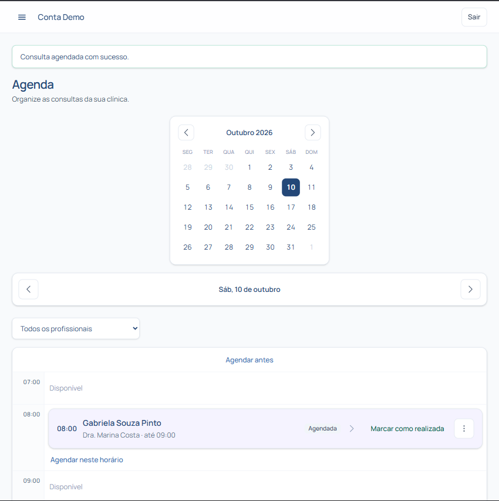

# Agenda

A **Agenda** do Proton permite gerenciar e organizar todos os horários de atendimento da clínica, otimizando o fluxo de consultas e evitando conflitos de horários.

---

## Modos de visualização

Você pode alternar o formato de exibição da agenda no topo da tela:

- **Dia:** Exibe a grade de horários detalhada para o dia selecionado.
- **Semana:** Apresenta a visão geral de todos os dias da semana, ideal para planejamento semanal.
- **Mês:** Oferece uma visão panorâmica dos dias com atendimentos agendados no mês.

---

## Agendando uma consulta

1. No menu lateral, clique em **Agenda**.
2. Clique diretamente no **bloco de horário desejado** na grade da agenda ou no botão **+ Novo Agendamento**.
3. Selecione o **paciente** cadastrado (ou utilize a busca rápida).
4. Defina o **tipo de procedimento**, a **duração** e o profissional responsável.
5. Clique em **Agendar**.

---

## Alterando o status da sessão

Durante o dia a dia, você pode atualizar a situação de cada atendimento:

1. Clique no card do agendamento desejado na grade.
2. Selecione o novo status da consulta:
   - 🔵 **Agendado:** Consulta marcada aguardando confirmação.
   - 🟢 **Confirmado:** Paciente confirmou a presença.
   - ✅ **Realizado:** Atendimento concluído.
   - 🔴 **Cancelado:** Consulta cancelada pelo paciente ou clínica.
   - 🟡 **Falta:** Paciente não compareceu ao horário agendado.
3. As alterações são salvas automaticamente e refletidas visualmente na agenda.

---

## Remarcando ou cancelando consultas

- **Remarcar por arrastar e soltar (Drag & Drop):** Na visão diária ou semanal, você pode clicar e segurar o card do agendamento e arrastá-lo para um novo horário ou dia disponível.
- **Cancelar consulta:** Clique sobre o card do agendamento, selecione a opção **Cancelar** e confirme o motivo do cancelamento se desejar registrar para histórico.

> 💡 **Dica:** Atendimentos marcados como **Realizado** abrem automaticamente o atalho para registrar a evolução no **Prontuário** do paciente.
