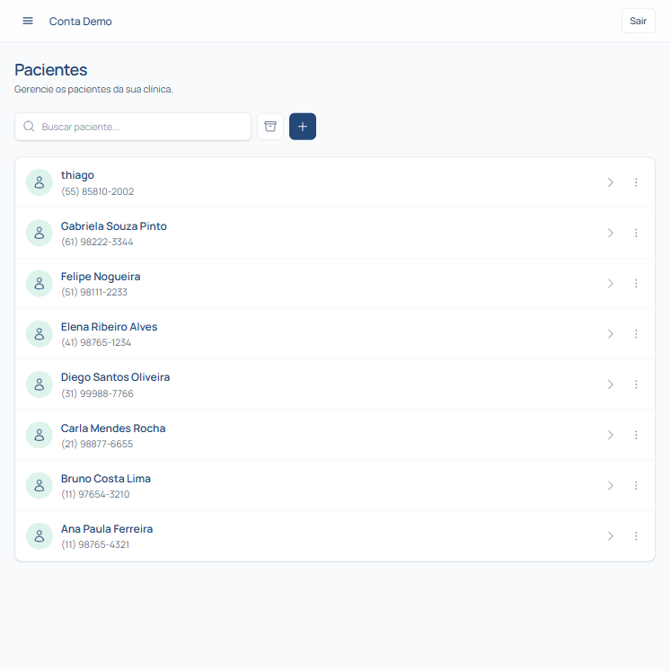

# Pacientes

O módulo de **Pacientes** é a central onde você gerencia o cadastro completo e o histórico de cada pessoa atendida na sua clínica.

---

## Buscando e filtrando pacientes

Para encontrar rapidamente o cadastro de um paciente:

1. Acesse o menu **Pacientes** no menu lateral esquerdo.
2. Utilize a barra de busca no topo da tela para digitar o **nome** ou **CPF** do paciente.
3. Você também pode aplicar filtros por **status** (Ativo, Inativo) ou **convênio**.
4. Clique sobre a linha correspondente ao paciente para abrir a ficha cadastral e o histórico completo.

---

## Cadastrando um novo paciente

1. No canto superior direito da tela de Pacientes, clique no botão **+ Novo Paciente**.
2. No formulário de cadastro, preencha os dados obrigatórios:
   - **Nome Completo**
   - **Telefone / WhatsApp**
   - **Data de Nascimento**
3. Preencha os campos adicionais conforme necessário (CPF, e-mail, endereço, convênio e observações gerais).
4. Clique em **Salvar** para concluir o cadastro.

> 💡 **Dica:** Certifique-se de preencher o número do WhatsApp com o DDD correto. Isso garante que o envio automático de lembretes de consulta funcione perfeitamente!

---

## Editando informações de um paciente

1. Abra a ficha do paciente desejado a partir da listagem.
2. Clique no botão **Editar Cadastro** no canto superior da ficha.
3. Altere as informações necessárias no formulário.
4. Clique em **Salvar alterações** para atualizar o cadastro.

---

## Vídeo explicativo

  <iframe width="560" height="315" src="https://www.youtube.com/embed/cGp9OVO9SAo?si=yrlk-T5EtUlOuxme" title="YouTube video player" frameborder="0" allow="accelerometer; autoplay; clipboard-write; encrypted-media; gyroscope; picture-in-picture; web-share" referrerpolicy="strict-origin-when-cross-origin" allowfullscreen></iframe>

