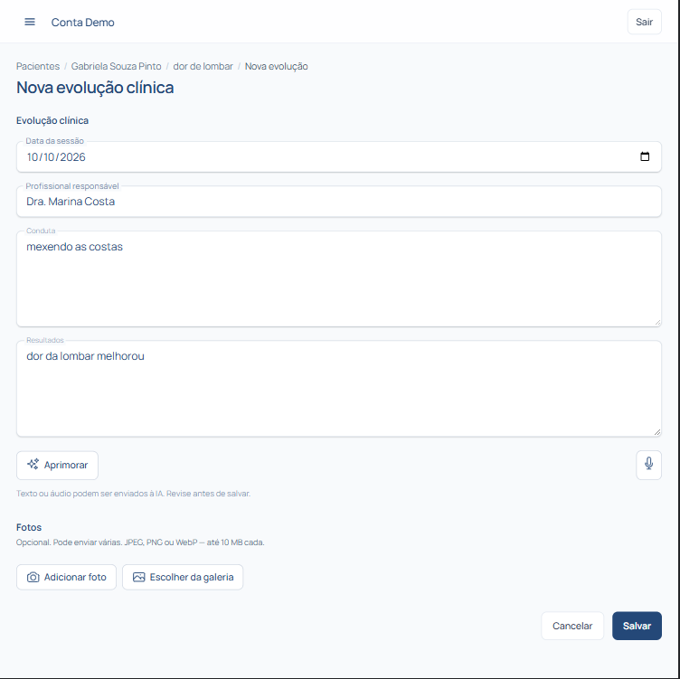

# Prontuário Eletrônico

O **Prontuário** do Proton foi desenhado para facilitar e agilizar o registro clínico dos atendimentos de fisioterapia, mantendo o histórico de evolução do paciente organizado e seguro.

---

## Registrando a evolução do atendimento

Você pode registrar o atendimento de duas formas: **Registro Manual** ou **Prontuário Inteligente por Voz (IA)**.

### Opção 1: Registro por Voz (IA) 🎙️

1. Abra a ficha do paciente e clique em **Nova Evolução**.
2. Clique no ícone de **Microfone** para ativar o assistente de voz.
3. Descreva o atendimento falado naturally (ex: queixas relatadas, testes realizados, exercícios aplicados e evolução do quadro).
4. Clique em **Concluir Gravação**. A Inteligência Artificial do Proton irá processar o áudio e estruturar o texto automaticamente nos campos adequados.
5. Revise as informações geradas e clique em **Salvar Evolução**.

### Opção 2: Registro Manual 📝

1. Na ficha do paciente, selecione **Nova Evolução**.
2. Preencha os campos texto de avaliação, conduta e observações clínicas.
3. Clique em **Salvar Evolução**.

---

## Consultando o histórico clínico

- Toda evolução salva fica registrada em ordem cronológica na linha do tempo do paciente.
- Na barra lateral do prontuário, você pode consultar evoluções anteriores a qualquer momento durante a sessão atual.
- É possível filtrar históricos por data ou tipo de tratamento realizado.

> 💡 **Dica:** O uso do prontuário por voz economiza tempo entre as consultas e garante um registro clínico detalhado sem digitação exaustiva.
